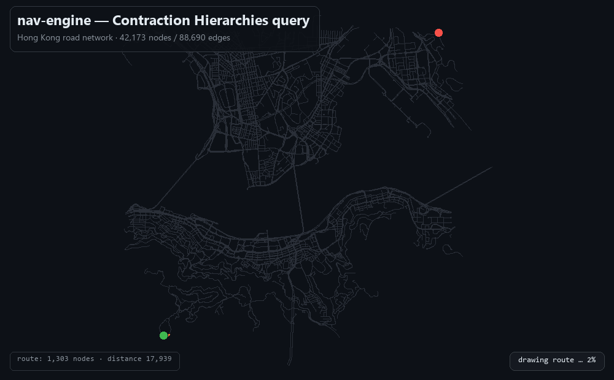

# nav-engine

[](https://github.com/wangyiuso-star/nav-engine/actions/workflows/ci.yml)
[](#build)
[](#build)
[](LICENSE)

A from-scratch **C++17 route-planning engine** for real road networks: **Dijkstra**, **A\***,
**ALT** (A\* + landmarks + triangle inequality) and **Contraction Hierarchies**, implemented on
top of a hand-written graph, with full **route reconstruction** — every algorithm returns the
node-by-node path, not just the distance.

Around **1,000 lines of C++** (plus 190 lines of tests), STL only, on a
**42,173-node / 88,690-edge** OpenStreetMap extract — a **≈9.5 km × 9.0 km** slice of central
Hong Kong around Victoria Harbour (Hong Kong Island north shore + Kowloon peninsula), not the
whole territory. Contraction Hierarchies answers a cross-city query in **8.8 µs** while touching
**428 of 42,173 nodes** — **98× fewer than Dijkstra**, and **3.1× faster than the same code
before profiling**.



## The 30-second version

| | |
|---|---|
| **What** | point-to-point shortest path on a road network — *which roads do I drive down*, not only *how far is it* |
| **Result** | CH: **428 nodes expanded, 8.8 µs/query** vs Dijkstra: **41,758 nodes, 2.8 ms** on the same data |
| **Why it is trustworthy** | all four algorithms must agree on the distance, and each reconstructed route is re-summed on the **original** edge weights — a passing check proves the CH shortcuts were fully unpacked |
| **How it was tuned** | not by guessing: `callgrind` said the bottleneck was 422 KB of per-query allocation + zeroing; fixing that took the query from 26.8 µs to 8.8 µs |
| **Engineering** | CMake (Release by default), CTest, an NDEBUG-safe `CHECK`, gcc + apple-clang CI matrix, ASan/UBSan CI job, `clang-format` gate |

**If you have two minutes:** [benchmark table](#benchmark-results) →
[where the 3.1× came from](#performance-engineering) →
[the ALT landmark experiment](#landmark-selection-strategy--count-k-alt).

## Build

```bash
cmake -S . -B build          # Release (-O3 -DNDEBUG) is the default build type
cmake --build build -j
ctest --test-dir build --output-on-failure
./build/nav_cli hk_metro.txt
```

Requires a C++17 compiler and CMake ≥ 3.16. If you change the build type, re-run CMake from a
clean cache (`rm -rf build`) — CMake caches `CMAKE_BUILD_TYPE`.

Because `Release` defines `NDEBUG`, the tests do **not** use `<cassert>`: they use an
NDEBUG-safe `CHECK` macro (`tests/check.hpp`) so assertions stay active in optimised builds.

Expected output on the bundled Hong Kong network — node counts are exact, timings are one
representative run and move a few percent between runs and machines:

```
loading map: hk_metro.txt ... 42173 nodes, 88690 edges
Dijkstra (point-to-point)     :   2.96 ms   41758 nodes expanded   dist = 17939
  path 1303 nodes, re-summed 17939 (dist 17939) [ok]
A* + Euclidean                :   2.83 ms   30121 nodes expanded   dist = 17939
  path 1303 nodes, re-summed 17939 (dist 17939) [ok]
A* + ALT (farthest, K=8)      :   0.12 ms    1303 nodes expanded   dist = 17939
CH preprocessing              : 165.00 ms
CH first query                :   0.05 ms     428 nodes expanded   dist = 17939
CH 2000 queries               :   9.38 us/query   checksum = 35878000
  path 1303 nodes, re-summed 17939 (dist 17939) [ok]
all algorithms agree: dist = 17939
```

## Algorithms

| Algorithm | Status | Description |
|-----------|--------|-------------|
| Dijkstra (SSSP + point-to-point) | ✅ | Baseline single-source and early-stopping variants |
| A\* | ✅ | Admissible heuristic + tie-breaking (larger `g` first) |
| ALT | ✅ | A\* + landmarks + triangle-inequality lower bounds |
| Contraction Hierarchies | ✅ | Node contraction, witness search, shortcut unpacking |
| Path reconstruction | ✅ | All four algorithms return the full route (CH unpacks shortcuts recursively) |

`nav_cli` picks the two most distant nodes in the graph, runs every algorithm, verifies they agree
on the shortest distance, reconstructs each route, and re-sums its weights on the original graph.
It exits non-zero if anything disagrees — which is what the CI end-to-end step relies on.

```bash
./build/nav_cli hk_metro.txt --dump-path route.txt   # one "node_id x y" line per route node
```

## Benchmark results

Graph: **≈9.5 km × 9.0 km** of central Hong Kong around Victoria Harbour (Hong Kong Island north
shore + Kowloon peninsula), **42,173 nodes / 88,690 edges**, taken from OpenStreetMap via the
Overpass API — a community dataset, not the government's official road network. Node counts are
deterministic; timings are from `-O3` builds and vary a few percent run to run.

| Algorithm | Nodes expanded | Query time | Shortest distance |
|-----------|---------------|------------|-------------------|
| Dijkstra (point-to-point) | 41,758 | 2.8 ms | 17,939 |
| A\* (Euclidean heuristic) | 30,121 | 2.6 ms | 17,939 |
| A\* + ALT (farthest, K=8) | 1,303 | 0.13 ms | 17,939 |
| **Contraction Hierarchies** | **428** | **8.8 µs** | 17,939 |

CH preprocessing cost: ~165 ms (one-time, offline).

**CH expands ~98× fewer nodes than Dijkstra.** Interestingly, CH touches only 428 nodes
while the shortest path itself is **1,303 nodes long** — the 875-node gap is exactly what
shortcuts compress away. All three path-reconstructing algorithms independently produce the
same 1,303-node route, and a verifier re-sums the weights on the **original** graph to
confirm it equals the reported distance (which also proves shortcuts were fully unpacked).

### Landmark selection strategy × count K (ALT)

Nodes expanded, fewer is better:

| strategy | K=4 | K=8 | K=16 | K=32 |
|----------|-----|-----|------|------|
| random   | 16,196 | 12,333 | 8,365 | 4,825 |
| farthest | **1,303** | **1,303** | **1,303** | **1,303** |
| boundary | 1,652 | 1,633 | 1,628 | 1,303 |

The greedy "farthest" landmark selection saturates at K=4 (it picks the four corners), which
is optimal for a cross-city query. Random selection is unstable and needs ~8× more landmarks
to approach it — a concrete demonstration that **landmark placement, not just landmark count,
determines ALT's performance**.

## Performance engineering

The CH query was optimised on top of `callgrind` data rather than intuition:

1. **Build configuration first.** The project originally had no `CMAKE_BUILD_TYPE`, so every
   measurement was from an unoptimised build. Setting `Release` improved every algorithm by
   3–6× — before touching a single line of algorithm code.
2. **Profile.** `callgrind` showed `CH::query` at 26.3% of all instructions, with `memset`
   (6.9%) plus the allocator (`malloc`/`free`/`operator new`, ~15%) dominating. The bottleneck
   was not the search — it was **allocating and zeroing ~422 KB of per-query scratch arrays**
   plus an O(n) scan over all nodes to find the meeting point.
3. **Optimise.** Reusable member buffers + a "touched list" that resets only the ~428 nodes
   actually visited (instead of clearing all 42,173), an O(settled) meeting scan, and a manual
   heap over a reused vector (removing the last per-query allocation).
4. **Re-measure.** CH query: **26.8 µs → 8.8 µs (3.1×)**; the first (cold) query improved
   0.70 ms → 0.044 ms (16×), because the per-query 422 KB allocation is gone.

The buffers are reused across queries, which makes `CH::query` **not thread-safe** — a trade-off
that is documented in `include/nav/ch.hpp` along with the alternative (thread-local buffers, or
one query object per thread).

Known remaining costs (measured, not yet addressed): iostream-based file loading (~5.6% of
instructions — `operator>>` formatting is slow), `std::unordered_map` in the witness search,
and `std::function` type-erasure in A\*'s hot loop (A\* does *fewer* instructions than Dijkstra
yet can take *more* time — an instruction-count profile cannot see indirect-call costs).

## Correctness

- `test_dijkstra` — distances, path reconstruction, `path_cost` edge cases
- `test_astar` — heuristic correctness, path reconstruction, unreachable handling
- `test_ch` — CH vs Dijkstra on all node pairs, plus a **6-cycle graph that is guaranteed to
  produce a shortcut**, so the recursive shortcut-unpacking path is always exercised

CI runs the same tests twice (optimised build, and Debug under ASan + UBSan), plus an end-to-end
`nav_cli` run on a deterministic synthetic grid, and a `clang-format` gate pinned to a fixed
version so formatting cannot drift with the runner image.

## Limitations / what I would do next

- **Node-based routing, not edge-based.** Turn restrictions (no left turn), turn penalties and
  one-way streets are not modelled — the OSM importer deliberately emits both directions for
  every way. Real production routing is edge-based for exactly this reason.
- **The CH implementation assumes a symmetric graph**, which matches the importer above. True
  one-way support needs a separate down-graph and edge-disjoint searches.
- **Fixed integer weights, no time dependence.** No traffic profiles, no multi-criteria
  (time vs distance vs toll) optimisation.
- **Single-threaded, single query.** No batch/many-to-many API, no parallelism, no server
  process — this is a deliberate scope choice: the interesting part is the algorithm and the
  measurement discipline, not deployment.
- **Preprocessing is offline and in-memory.** No graph serialisation, so CH is rebuilt per
  process start (~165 ms here).
- **The bundled dataset is a small slice.** ≈86 km² of central Hong Kong (≈9.5 × 9.0 km); the
  New Territories, Lantau and the outlying islands are not in it. `tools/fetch_osm.py` takes a
  bbox, so a territory-wide extract is one command away — but a bigger extract will contain
  one-way streets, which the importer deliberately flattens and CH assumes away (see above).

## Data

### What the bundled dataset actually is

| | |
|---|---|
| **Source** | OpenStreetMap via the Overpass API — a community dataset, **not** an official government road network |
| **Coverage** | ≈9.5 km × 9.0 km bounding box (≈86 km²) around Victoria Harbour: Hong Kong Island north shore + Kowloon peninsula |
| **Size** | 42,173 nodes / 88,690 edges, motor roads only (`motorway` … `residential`, no footpaths or cycleways) |
| **Coordinates** | **Metres, not lat/lon** — equirectangular projection around the bbox centre, so absolute position depends on the bbox used at fetch time |
| **Edge weight** | Straight-line distance in metres, rounded up (keeps the Euclidean heuristic admissible) |
| **Missing** | New Territories, Lantau and the outlying islands; one-way and turn restrictions |

Everything else — including a different city, or a government dataset converted to this format —
works without touching the algorithms: the engine only ever sees the text format below. The one
thing to watch is directionality (see the CH caveat in *Limitations*).

### File format

The engine reads a simple text format, produced by the scripts in `tools/`:

```
n m            # node count, edge count
x y            # n lines of node coordinates
...
u v w          # m lines of directed edges
...
```

```bash
# synthetic obstacle grid (deterministic, good for CI)
python3 tools/gen_grid.py 300 300 0.2 grid.txt

# real road network from OpenStreetMap (Overpass API)
python3 tools/fetch_osm.py 22.26 114.14 22.33 114.22 hk_metro.txt
```

`hk_metro.txt` is committed so the numbers above reproduce on a fresh clone;
generated/downloaded graphs are otherwise git-ignored.

The demo images are generated from a real query, not hand-drawn:

```bash
./build/nav_cli hk_metro.txt --dump-path route.txt
python3 tools/render_demo.py hk_metro.txt --path route.txt   # writes docs/demo.gif + docs/route.png
```

## Project layout

```
nav-engine/
├── CMakeLists.txt          # build recipe (default: Release)
├── include/nav/            # interfaces (headers)
│   ├── graph.hpp
│   ├── dijkstra.hpp
│   ├── astar.hpp
│   ├── landmarks.hpp
│   ├── ch.hpp
│   ├── path.hpp
│   ├── io.hpp
│   └── stats.hpp
├── src/                    # implementations
│   ├── dijkstra.cpp
│   ├── astar.cpp
│   ├── landmarks.cpp
│   ├── ch.cpp
│   ├── path.cpp
│   └── io.cpp
├── app/main.cpp            # benchmark + verification CLI
├── tests/                  # unit tests (ctest)
│   ├── check.hpp
│   ├── test_dijkstra.cpp
│   ├── test_astar.cpp
│   └── test_ch.cpp
├── tools/                  # data generation / fetching, demo rendering
│   ├── gen_grid.py
│   ├── fetch_osm.py
│   └── render_demo.py
├── docs/                   # demo.gif, route.png
├── .github/workflows/      # CI: build+test matrix, ASan/UBSan, clang-format
├── .clang-format
└── LICENSE
```

## License

MIT
